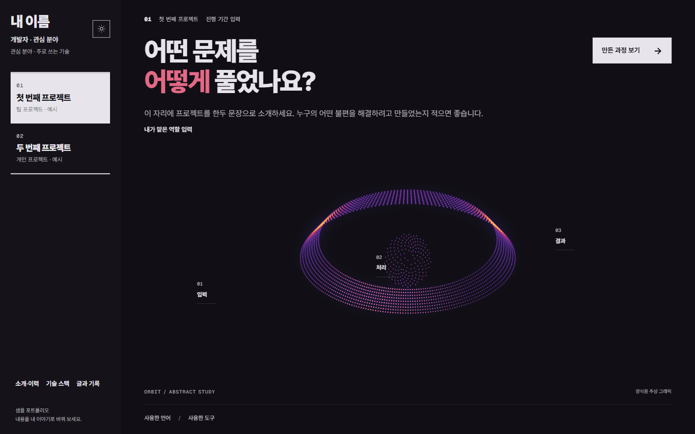
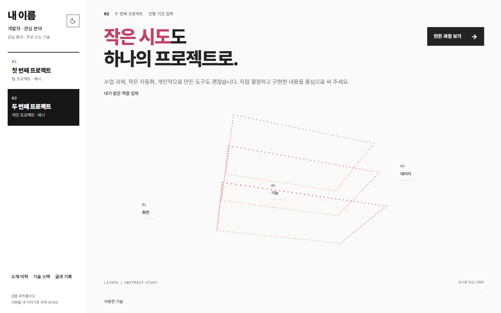
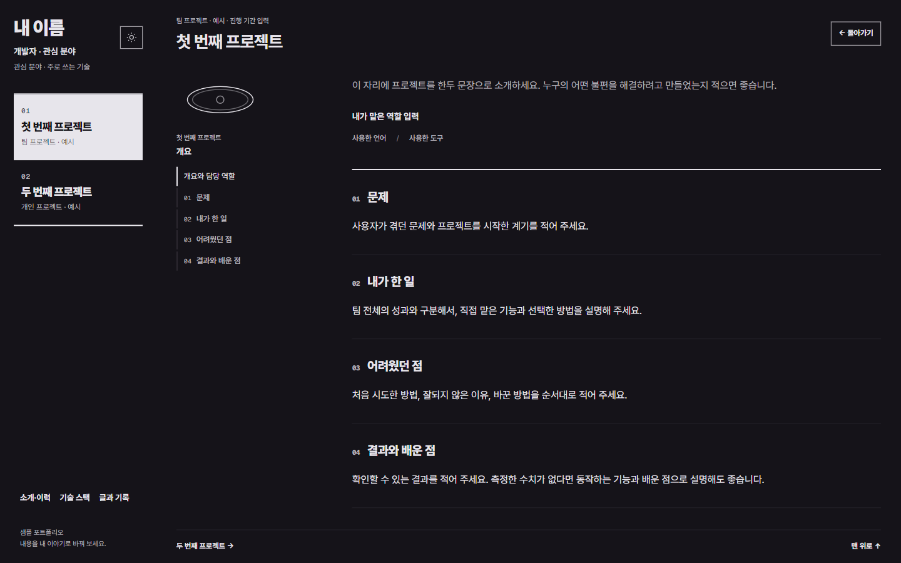
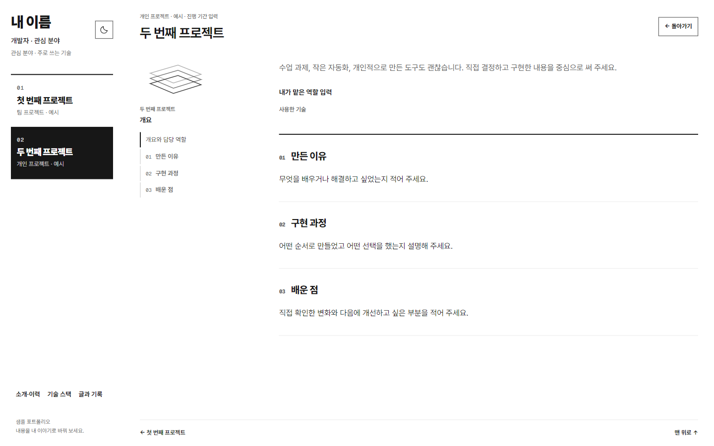
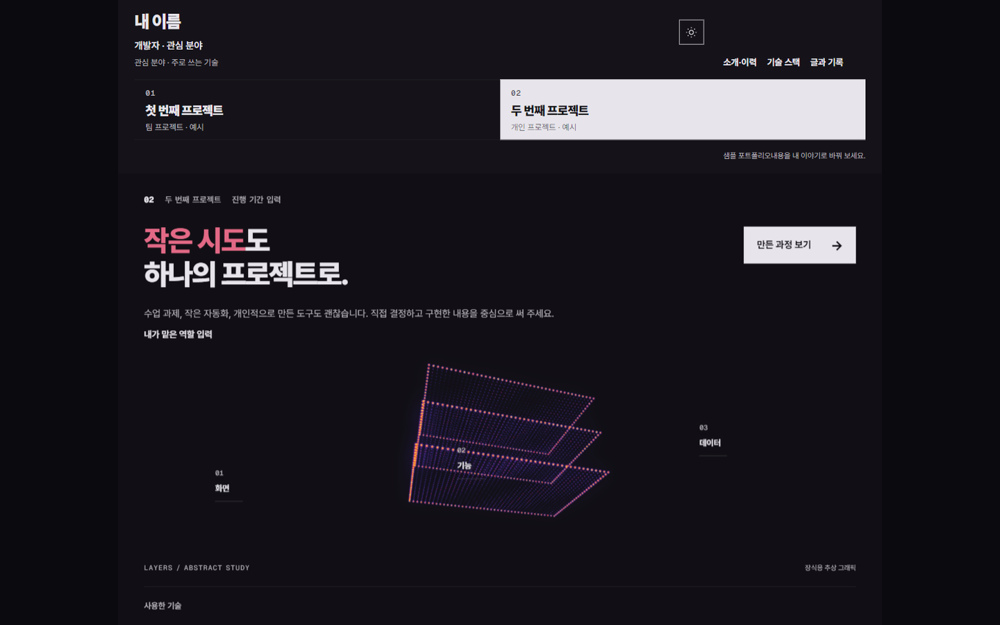
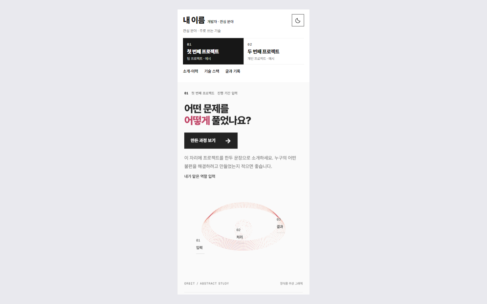

# Portfolio Template

**인터뷰로 사실을 정리하고, 정적 사이트로 배포하는 에이전트 기반 포트폴리오 템플릿**


코딩 에이전트가 사용자의 경험을 질문으로 끌어내고, 확인된 사실만 `content/portfolio.json`에 기록해 사이트로 만듭니다. 웹 개발 경험이 없어도 수업 과제, 팀 프로젝트, 작은 도구부터 시작할 수 있습니다. 서버·데이터베이스·유료 서비스 없이 GitHub Pages에서 동작합니다.



## 특징

- **사실 중심 작성** — 에이전트가 시작한 이유, 본인 기여, 막힌 지점, 확인한 결과를 단계적으로 질문합니다. 근거 없는 성과·수치·경력은 기록하지 않습니다. 모르는 항목은 `미확인`으로 두거나 제외합니다.
- **데이터와 화면의 분리** — 이름·프로젝트·기술·글은 JSON 한 파일로 관리합니다. 코드를 수정하지 않고 내용을 교체할 수 있습니다.
- **일관된 아트 디렉션** — 점광원으로 그린 추상 그래픽, Pretendard·Geist Mono 타이포그래피, 얇은 구분선과 제한된 강조색을 사용합니다. 규칙은 문서와 검사 스크립트로 보존합니다.
- **자유로운 색 구성** — 밝은·어두운 테마의 색과 그림 팔레트를 `content/theme.json`에서 바꿉니다.
- **반응형 상세 읽기 화면** — 카테고리 레일과 상세 레일이 독립적으로 접히며, 프로젝트별 공유 가능한 상세 주소를 제공합니다.
- **검증된 배포 흐름** — 콘텐츠 형식, 아트 토큰, 정적 내보내기 결과와 경로를 빌드 단계에서 검사하고, GitHub Actions로 배포합니다.

## 미리보기

기본 샘플 화면입니다. 위 줄은 데스크톱(홈 어두움·홈 밝음·상세 어두움), 아래 줄은 상세 밝음·태블릿·모바일입니다.

| | | |
|---|---|---|
|  |  |  |
|  |  |  |

> 샘플의 이름·프로젝트·그래픽은 입력 안내용 장식입니다. 실제 경력이나 시스템 구조를 나타내지 않습니다.

## 작동 방식

```
인터뷰  →  사실 정리  →  콘텐츠 작성  →  화면 확인  →  배포
(질문)     (private/)    (content/)     (미리보기)    (GitHub Pages)
```

1. 에이전트가 [AGENTS.md](AGENTS.md)의 규약에 따라 프로젝트마다 상황·본인 행동·결과를 묻습니다.
2. 확인된 답은 비공개 메모(`private/INTERVIEW.md`, Git 제외)에 정리합니다.
3. 정확성을 확인한 초안만 `content/portfolio.json`에 반영합니다.
4. 라이트·다크·모바일에서 화면을 확인하고 검증을 통과한 뒤 배포합니다.

## 시작하기

### 1. 저장소 만들기

이 저장소 상단의 **Use this template → Create a new repository**를 선택합니다. 이름은 `my-portfolio` 형식을 권장하며, 무료 GitHub Pages를 쓰려면 Public으로 생성합니다.

### 2. 에이전트에게 작업 요청

새 저장소를 Codex, Claude Code, Cursor, GitHub Copilot 등 코딩 에이전트에서 열고(저장소 폴더 접근 필요) 아래 요청문을 붙여 넣습니다.

```text
이 저장소의 AGENTS.md를 끝까지 읽고, 규정된 응답 형식과 인터뷰 절차를 따라 줘.
나는 웹 개발을 잘 모르고 이 템플릿으로 내 포트폴리오를 만들고 싶어.
내 프로젝트와 직접 한 일을 구체적으로 캐물어 줘. 답이 추상적이면 후속 질문을 해 줘.
내가 모르는 내용은 만들어 내지 말고, 확인된 사실만 공개할 글로 정리해 줘.
디자인과 아트 규칙은 유지하고, 내가 답한 내용을 사이트에 반영해 줘.
처음에는 확인한 내용 / 이번 질문 / 다음 작업 순서로 답해 줘.
```

평소 말하듯 답하면 됩니다. "모르겠어요", "이건 공개하지 않을래요", "여기까지만 묻고 만들어 주세요"도 유효한 답입니다. 기존 README나 발표 자료가 있으면 정확도가 올라가지만 필수는 아닙니다.

### 3. 확인하고 수정하기

화면을 보고 구체적으로 요청합니다.

```text
미리보기를 열어 줘. 휴대폰 너비에서도 확인해 줘.
첫 번째 프로젝트에서 로그인은 팀원이 했고, 나는 검색 기능을 맡았어. 그 부분을 고쳐 줘.
수치는 측정한 적이 없으니 빼고, 실제로 동작하는 기능을 설명해 줘.
```

### 4. 배포하기

저장소 소유자 권한으로 **Settings → Pages → Build and deployment → Source**를 **GitHub Actions**로 한 번 설정합니다. 이후 에이전트에게 요청하거나 직접 배포합니다.

```text
이제 내 GitHub 저장소에 공개 배포해 줘.
원격 저장소가 내 저장소인지 확인하고, 테스트·빌드·타입 검사와 개인정보 점검을 해 줘.
GitHub Pages 설정도 확인하고, 완료되면 실제 접속되는 사이트 주소를 알려 줘.
```

- `main`에 변경을 올리거나 **Actions → Deploy portfolio to GitHub Pages → Run workflow**를 실행하면 배포됩니다. 복사한 저장소에서 Actions 허용 안내가 보이면 활성화하세요.
- 사이트 경로(`basePath`)는 저장소 이름에서 자동으로 설정됩니다. 주소는 보통 `https://<계정>.github.io/<저장소>/`이고, 저장소 이름이 `<계정>.github.io`이면 루트 주소입니다. 사용자 지정 도메인은 Pages 설정의 주소를 따릅니다.
- 공개 저장소(소스 코드)와 배포된 사이트는 별개입니다. 자세한 설정은 [GitHub Pages 공식 안내](https://docs.github.com/en/pages/getting-started-with-github-pages/configuring-a-publishing-source-for-your-github-pages-site)를 참고하세요.

## 커스터마이징

| 바꿀 것 | 파일 | 문서 |
|---|---|---|
| 이름·소개·프로젝트·기술·글·연락처 | `content/portfolio.json` | [콘텐츠 안내](docs/CONTENT_GUIDE.md) |
| 밝은/어두운 테마 색, 그림 팔레트 | `content/theme.json` | [색 변경 안내](docs/THEME_GUIDE.md) |
| 프로젝트 그래픽 종류 (`orbit`, `layers`, `flow`, `none`) | `content/portfolio.json`의 `art` | [콘텐츠 안내](docs/CONTENT_GUIDE.md) |
| 레이아웃·상세 화면 동작 | `src/components/`, `src/app/globals.css` | [상세 읽기 UX](docs/DETAIL_UX.md) |

색은 에이전트에게 "강조색은 청록, 어두운 화면은 짙은 남색으로 맞춰 줘"처럼 요청해도 됩니다. 레이아웃과 아트 문법은 유지되며, 기본 색을 고수할 필요는 없습니다.

## 개발 환경

Node.js 24 권장(최소 22). Next.js 정적 내보내기를 사용하므로 별도 서버나 데이터베이스가 필요하지 않습니다.

```sh
npm ci --ignore-scripts   # 의존성 설치
npm run dev               # 개발 서버  http://127.0.0.1:3000
npm test                  # 단위 테스트
npm run check-art         # 아트 토큰·폰트·문서 검사
npm run build             # 콘텐츠·아트 검사 + 정적 빌드 + 내보내기 검증 (out/)
npm run check-types       # 타입 검사
npm run preview           # 빌드 결과 미리보기  http://127.0.0.1:4173
```

서브 경로에 배포하는 경우 실제 저장소 경로로 다시 빌드해 확인합니다.

```sh
PAGES_BASE_PATH=/my-portfolio npm run build          # macOS / Linux
$env:PAGES_BASE_PATH='/my-portfolio'; npm run build  # PowerShell
```

`npm run check-art`는 사용자의 색 선택을 제한하지 않습니다. 토큰 누락·형식 오류·CSS/셰이더 간 중복 정의·폰트 범위를 검사하며, 의미·미감·명암·동작은 실제 미리보기에서 별도로 확인해야 합니다.

## 저장소 구조

```
content/            portfolio.json, theme.json — 공개 콘텐츠와 색
src/app/            레이아웃, 전역 스타일, 프로젝트 상세 라우트
src/components/     화면 구성, 상세 읽기 화면, 추상 그래픽, 점광원 렌더러
scripts/            콘텐츠·아트·내보내기 검사, 정적 미리보기 서버
docs/               콘텐츠·색·아트·상세 UX 문서, 스타일 기준값(docs/art/)
public/             폰트와 라이선스 고지
.github/workflows/  GitHub Pages 배포 워크플로
```

## 문서

- [에이전트 작업 규약](AGENTS.md) — 인터뷰 방식, 응답 형식, 사실 확인, 검증·배포
- [디자인과 아트 규칙](docs/ART_DIRECTION.md) — 레이아웃, 색, 타이포그래피, 빛 표현
- [아트 스타일](docs/ART_STYLE.md) · [구현 레시피](docs/ART_RECIPES.md) · [판단 기록](docs/ART_DECISIONS.md) · [검수 규격](docs/ART_REVIEW.md)
- [콘텐츠 안내](docs/CONTENT_GUIDE.md) — JSON 필드, 이미지, 링크, 빈 목록
- [색 변경 안내](docs/THEME_GUIDE.md) — 색 토큰, 밝음/어두움, 그림 팔레트
- [상세 읽기 UX](docs/DETAIL_UX.md) — 레일 접힘, 현재 위치·목차, 공유용 상세 주소

## 자주 묻는 질문

**프로젝트가 하나뿐이어도 되나요?**
네. 하나만 둬도 되고, 프로젝트가 없는 상태도 동작합니다. 경력·수상이 없으면 빈 목록이 정상입니다.

**팀 프로젝트나 AI로 만든 작업은 어떻게 적나요?**
팀 전체의 결과와 본인이 맡은 부분을 구분하고, AI에게 맡긴 범위와 직접 결정·검토·실행해 검증한 범위를 나누어 말해 주세요. 실제 분담대로 기록됩니다.

**스크린샷이나 사진이 꼭 필요한가요?**
아닙니다. 없으면 추상 그래픽이 표시됩니다. 화면 캡처를 쓰려면 파일을 에이전트에게 주고 교체를 요청하세요.

**질문이 너무 많아요.**
경험을 지어내지 않고 구체적인 글을 쓰기 위한 절차입니다. "여기까지만 묻고 만들어 주세요"라고 하면 확보된 사실만으로 진행합니다.

**수정 후 다시 배포하려면요?**
`main`에 올리면 자동으로 재배포됩니다. 수정과 배포를 에이전트에게 함께 요청해도 됩니다.

**어떤 내용이 공개되나요?**
`content/`와 공개 파일에 반영한 내용은 모두 공개됩니다. 공개하면 안 되는 정보는 인터뷰 중 먼저 알려 주세요. 인터뷰 메모용 `private/`는 Git에서 제외됩니다.

> 에이전트의 지침 준수 정도는 도구와 모델에 따라 다릅니다. 첫 요청에서 `AGENTS.md`를 읽도록 명시하고, 작성된 내용이 실제 경험과 맞는지 직접 확인하세요.

## 라이선스

[MIT License](LICENSE) — Copyright (c) 2026 jihyun-el.

Pretendard와 Geist Mono는 SIL Open Font License로 배포하며, 고지는 `public/fonts/Pretendard-LICENSE.txt`와 `public/fonts/GeistMono-LICENSE.txt`에 있습니다. 템플릿의 MIT 고지와 폰트 고지는 함께 유지해 주세요.

---

다 만들고 나면 알려 주세요. 여러분이 만든 포트폴리오가 궁금합니다.
